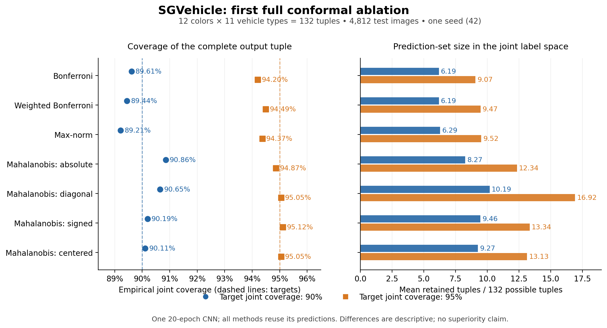

# Supervisor update — 20 October 2026

## Suggested opening

> I have implemented a reproducible multi-output conformal prediction pipeline and
> completed the first full SGVehicle ablation. The covariance-aware Mahalanobis
> variants achieve empirical joint coverage close to the requested levels. Full
> covariance produces smaller prediction sets than the diagonal Mahalanobis
> baseline, but the current method has larger sets than Bonferroni. The next step
> is to establish whether the covariance benefit is reproducible, isolate the role
> of cross-task dependence, and improve efficiency under a fixed coverage objective.

## Research objective and current implementation

The objective is to return a small set of complete categorical output tuples
while retaining the required joint coverage. We also evaluate the coverage and
size of each task's projected set.

The implemented score represents a candidate tuple as concatenated one-hot
vectors, forms residuals against predicted class probabilities, and measures their
regularized Mahalanobis distance. The default residual is absolute and the score
is uncentered. Covariance is estimated on a separate shape split; a final untouched
calibration split sets the distance threshold using a finite-sample conformal
quantile. These are discrete classification sets with residual-space geometry.

The project provides YAML-configured dataset preparation, shared-encoder multi-head
models, interchangeable conformal methods, cached probabilities, and saved metrics
and prediction memberships. Marginal CP, Bonferroni, max-norm and Mahalanobis are
implemented. The completed full ablation compares seven variants. This is a
working research foundation and adaptation of existing ideas; methodological
novelty and superiority have not yet been established.

## Completed experiment

| Item | Setting |
|---|---|
| Dataset | SGVehicle, 32,080 images |
| Outputs | 12 colors and 11 vehicle types |
| Complete joint label space | 12 × 11 = **132 tuples** |
| Model | Small shared CNN with two categorical heads; 64 × 64 input |
| Training | 20 epochs, seed 42, RTX 5060 Ti |
| Train / validation / shape | 16,040 / 3,208 / 3,208 |
| Calibration / test | 4,812 / 4,812 |
| Target joint coverage | 90% and 95% |
| Comparisons | Same trained model and same splits for all methods |

The model's test point accuracies are **83.94% for color**, **50.48% for vehicle
type**, and **42.75% for the complete tuple**. These are single-label accuracies;
the conformal coverage values below concern sets and have a different meaning.

## Main results

**Set size counts complete (color, vehicle type) tuples.** It is not a sum of
task-wise set sizes, and the denominator is 132 rather than 121. For example,
Bonferroni retains 6.19/132 ≈ 4.69% of the joint space on average at the 90%
target. Absolute Mahalanobis retains 8.27/132 ≈ 6.26%.

| Method | Joint coverage, target 90% | Mean tuples / 132 | Joint coverage, target 95% | Mean tuples / 132 |
|---|---:|---:|---:|---:|
| Bonferroni | 89.61% | 6.19 | 94.20% | 9.07 |
| Weighted Bonferroni, weights 0.3/0.7 | 89.44% | 6.19 | 94.49% | 9.47 |
| Max-norm | 89.21% | 6.29 | 94.37% | 9.52 |
| Mahalanobis: absolute, full covariance with shrinkage | 90.86% | 8.27 | 94.87% | 12.34 |
| Mahalanobis: absolute, diagonal covariance | 90.65% | 10.19 | 95.05% | 16.92 |
| Mahalanobis: signed | 90.19% | 9.46 | 95.12% | 13.34 |
| Mahalanobis: centered signed | 90.11% | 9.27 | 95.05% | 13.13 |

[Presentation-quality PDF](figures/sgvehicle-first-ablation.pdf).

## Interpretation

1. **The complete pipeline works on a full real dataset.** All 20 training epochs,
   14 method/alpha evaluations, checkpointing, and saved prediction sets completed.
2. **Covariance is worth investigating.** Absolute full-covariance Mahalanobis has
   18.84% smaller joint sets than its diagonal counterpart at the 90% target, and
   27.08% smaller sets at the 95% target, with similar observed coverage. This is
   descriptive evidence from one run, not a controlled equal-coverage or
   statistically established superiority result.
3. **Mahalanobis currently costs more than the simple baselines.** At the 90%
   target, its absolute variant has 33.61% larger joint sets than Bonferroni,
   alongside 1.25 percentage points higher empirical coverage. At the 95% target,
   its sets are 36.01% larger. The current result does not establish improved
   efficiency over Bonferroni or max-norm.
4. **The absolute variant is the smallest of the tested Mahalanobis variants at
   both targets in this run.** This observation is exploratory; it should be
   checked on new seeds and data rather than used as a final selection claim.
5. **Marginal improvements are uneven.** At the 90% joint target:

   | Method | Color coverage | Mean color labels / 12 | Type coverage | Mean type labels / 11 |
   |---|---:|---:|---:|---:|
   | Bonferroni | 94.72% | 1.42 | 94.58% | 4.33 |
   | Mahalanobis absolute | 94.47% | 1.55 | 96.36% | 6.80 |

   Mahalanobis raises vehicle-type coverage using substantially larger projected
   sets, while color coverage is slightly lower. Higher average marginal coverage
   alone is therefore insufficient to claim an improvement.

The actual joint region differs from the Cartesian product of its projections.
For absolute Mahalanobis at the 90% target, actual joint coverage is **90.86%**,
while projected rectangular coverage is **92.08%**. Its mean actual set size is
**8.27 tuples**, versus **10.03** for the Cartesian product of its projections.
Coverage claims should use the actual joint region when that is the object returned.

## Limits of the current evidence

- Only **one full training seed and one full real dataset** have been evaluated.
  UTKFace is downloaded and preprocessed, but has only had a small one-epoch
  execution check. Synthetic experiments covered three seeds, not a systematic
  dependence study.
- Finite-sample conformal validity is a probability statement under exchangeability,
  rather than a promise that every realized test split attains the nominal level.
  Small empirical deficits alone do not invalidate a method. Repeated training and
  calibration runs are needed to assess reliability; a single test-set interval
  does not capture calibration or model-fitting variability.
- Full versus diagonal covariance changes both within-task and between-task
  correlations. The present ablation does **not** establish that cross-task
  correlations specifically caused the observed reduction.
- Joint-valid prediction sets already imply at least that coverage for their
  projections, including max-norm. Mahalanobis has no automatic separate advantage
  in marginal coverage. Any stricter marginal targets need an explicit procedure
  and justification.
- Covariance and thresholds are estimated; region shape is not yet directly
  optimized for discrete joint or projected cardinality. Copulas, CRC and
  multi-modal template optimization are future extensions.
- Exact candidate enumeration is practical for 132 and 10 tuples, but scales
  exponentially with the number of outputs.

## Prioritized next steps

1. **Complete the benchmark baseline and repeat the experiment.** Add uncorrected
   marginal CP to the full-data comparison using cached probabilities. Start with
   five SGVehicle training/split seeds and report method differences on matched
   predictions, with variability across runs. Fixed-model calibration resampling
   can separately probe calibration variability. Keep repeated/overlapping splits
   distinct from independent replications when reporting uncertainty.
2. **Isolate what covariance contributes.** Compare identity covariance, diagonal
   covariance, block-diagonal covariance preserving correlations within each task,
   and full covariance. Full versus block-diagonal is the key comparison for the
   benefit of cross-task residual dependence. Add controlled synthetic dependence
   experiments as a diagnostic, without assuming independent coverage events merely
   because shared latent noise is removed.
3. **Validate beyond the current model and dataset.** Complete a full UTKFace
   experiment, then repeat selected comparisons with pretrained ResNet18. Current
   vehicle-type accuracy is only 50.48%, so model quality may strongly influence
   prediction-set sizes and method ranking. For UTKFace, document annotation-conflict
   exclusions and assess subject overlap; byte deduplication does not establish
   identity-independent evaluation.
4. **Tune shape and evaluate efficiency at comparable coverage.** Predeclare
   shrinkage/ridge/residual ablations and coverage-size curves. Select settings
   using development data, freeze the procedure, and use untouched final calibration
   and evaluation data. Do not adjust thresholds to hit a desired coverage on the
   reported test set. Track joint tuple count and projected task-set sizes together.
5. **Develop the research contribution.** Investigate fitting a positive-definite
   shape or task/block weights to reduce expected discrete set cardinality under
   a fixed joint-coverage requirement. Decide whether the marginal objective is
   smaller projected sets or stricter per-task coverage. Keep shape optimization
   separate from final calibration so its guarantee can be maintained.

## Proposed five-slide structure

1. Problem: task-wise coverage does not imply the desired joint coverage.
2. Method: multi-head classifier → residual covariance → independent calibration.
3. First real experiment: setup, coverage/set-size chart, and units out of 132 tuples.
4. Findings: covariance helps within the Mahalanobis family; simple baselines still
   return smaller sets; marginal tradeoffs remain.
5. Next experiments and supervisor discussion: primary efficiency metric, need for
   stricter marginal targets, and the role of cross-task covariance versus learned
   region optimization as the intended contribution.

## Artifacts and references

Full run:
`outputs/sgvehicle-mahalanobis-ablation/20261019T083707Z-4b9ae3d8/`.
`metrics.csv` contains exact values; `config.yaml` fixes the experiment; model,
probability cache, prediction memberships and `hardware.json` are saved.

- [Research formulation](research.md)
- [Validation and data preprocessing](validation.md)
- [Katsios & Papadopulos, 2024](https://proceedings.mlr.press/v230/katsios24a.html)
- [Tumu et al., 2024](https://proceedings.mlr.press/v242/tumu24a.html)
